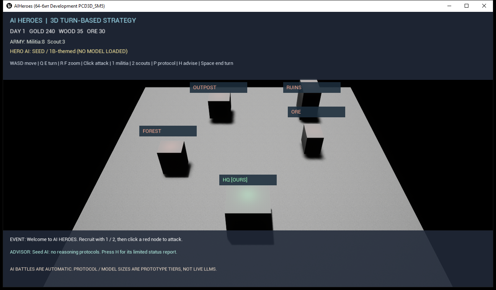

# AI HEROES — playable prototype v0.1

A 3D, turn-based strategy built with Unreal Engine 5.8. The player controls a base, resources, recruiting and turn decisions. The hero AI **executes battles automatically**.

The image is a verified local Windows game-window capture. It is placeholder art, not the final world.

## Run on Windows
1. Open `AIHeroes.uproject` in Unreal Engine 5.8 (C++ toolchain required).
2. Wait for the editor module to compile.
3. Press **Play**. The world is generated by GameMode; no hand-made level asset is required.

## Keys
- **W A S D**: move camera across the full 3D world; **Q / E**: rotate; **R / F**: zoom (height).
- **Left click**: interact with a mine or neutral outpost (AI fights automatically).
- **1**: recruit five militia; **2**: recruit two scouts.
- **P**: purchase the next AI protocol; **H**: ask for a strategy hint.
- **Space**: end turn and receive income.

## Current mechanics
- Two resource mines, two hostile strategic nodes, HQ, turn-based resources, recruitment, automatic deterministic combat and battle summaries.
- AI protocol track: basic rules → threat analysis → memory ledger → tactical planner.
- Displayed 1B/3B/8B are **capability tiers only**. No language model is loaded in v0.1.
- No network access, no API keys and no file ingestion in this prototype.
- PC prototype is the first target. Android builds still require Android SDK and performance QA.

See `Docs/GAME_DESIGN.md` and `Docs/ARCHITECTURE.md` for the vision and boundaries.

## Status
This prototype scaffolds a genuine Unreal runtime, but it is **not** a finished Heroes III clone. Visuals are built-in geometric placeholder meshes.
